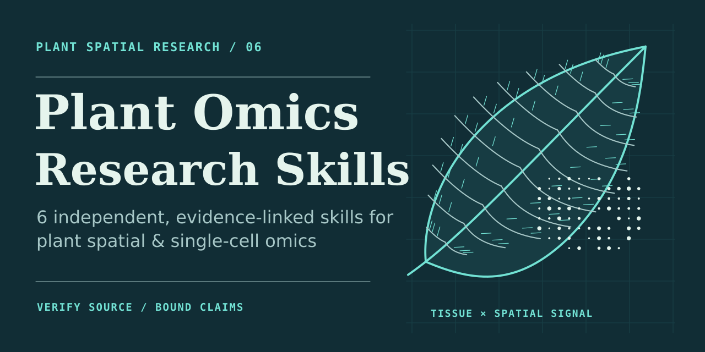
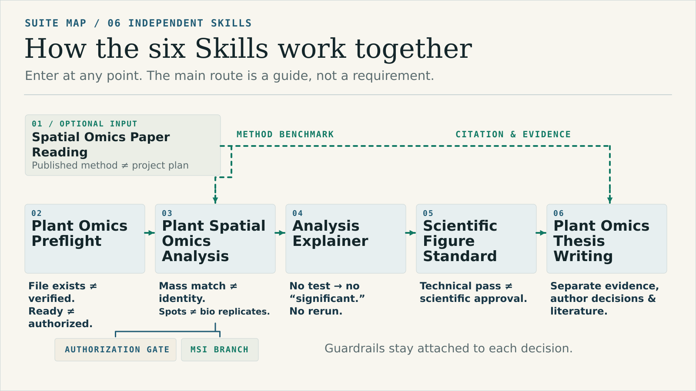
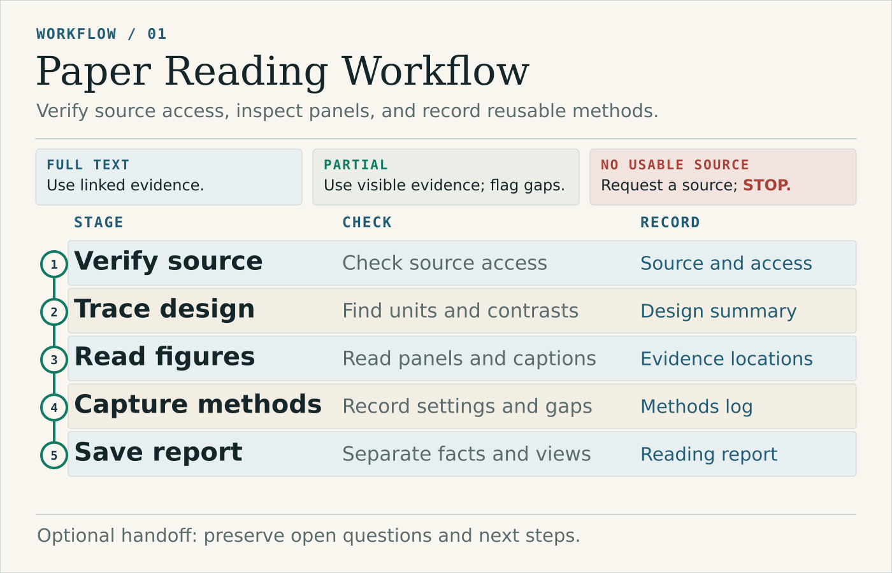
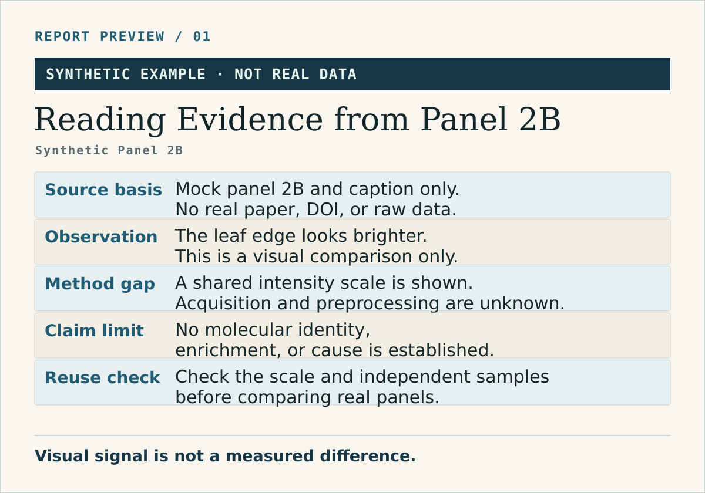

# Plant Omics Research Skills

English · [简体中文](README.zh-CN.md)

[](LICENSE)




Six independent Agent Skills for plant spatial and single-cell omics research. They provide evidence-linked workflows and guardrails, not an automated analysis pipeline. All bundled examples are synthetic and do not represent experimental findings.

## Core Guardrails

- A published method is not a project plan.
- File existence is not verification; readiness is not permission to execute.
- A mass match is not a confirmed compound; spots are not biological replicates.
- No statistical test, no claim of statistical significance. The explainer does not rerun analyses.
- A technical pass is not scientific approval.
- Keep evidence, author decisions, and literature distinct.

## How the Six Skills Fit Together



[Editable Mermaid source](assets/release/suite-architecture.mmd). Start wherever the task belongs. The routes show possible handoffs, not six mandatory steps.

## Choose a Skill

| Skill | When to use it | What you get | Visuals |
| --- | --- | --- | --- |
| [Spatial Omics Paper Reading](skills/spatial-omics-paper-reading/SKILL.md) | Read a published paper, figure panel, or method | An evidence-linked reading brief and, if requested, a handoff | [Workflow](assets/release/spatial-omics-paper-reading/workflow.png) · [Report preview](assets/release/spatial-omics-paper-reading/report-preview.png) |
| [Plant Omics Preflight](skills/plant-omics-preflight/SKILL.md) | Check data identity, readiness, or scope before proceeding | A readiness memo with verified inputs, blockers, and next checks | [Workflow](assets/release/plant-omics-preflight/workflow.png) · [Report preview](assets/release/plant-omics-preflight/report-preview.png) |
| [Plant Spatial Omics Analysis](skills/plant-spatial-omics-analysis/SKILL.md) | Plan, diagnose, or run an authorized comparison, including MSI | A bounded plan or documented comparison, with retention and evidence limits | [Workflow](assets/release/plant-spatial-omics-analysis/workflow.png) · [Report preview](assets/release/plant-spatial-omics-analysis/report-preview.png) |
| [Analysis Explainer](skills/analysis-explainer/SKILL.md) | Explain an existing result without rerunning the analysis | A source-linked Figure Summary with interpretation limits | [Workflow](assets/release/analysis-explainer/workflow.png) · [Report preview](assets/release/analysis-explainer/report-preview.png) |
| [Scientific Figure Standard](skills/scientific-figure-standard/SKILL.md) | Render, restyle, or audit figures from existing results | Figure exports and technical QA, without changing the source results | [Workflow](assets/release/scientific-figure-standard/workflow.png) · [Report preview](assets/release/scientific-figure-standard/report-preview.png) |
| [Plant Omics Thesis Writing](skills/plant-omics-thesis-writing/SKILL.md) | Draft or revise a thesis section from verified records | Evidence-aligned prose that preserves the author's decisions | [Workflow](assets/release/plant-omics-thesis-writing/workflow.png) · [Report preview](assets/release/plant-omics-thesis-writing/report-preview.png) |

## Quick Install

GitHub-based commands require access to the published repository. To use a local copy instead, follow the manual option.

**1. Open Agent Skills CLI.** Discover the available Skills and choose which to install. To install only one, pass its folder name to `--skill`.

```sh
npx skills add carrot-wangqian/plant-omics-research-skills
npx skills add carrot-wangqian/plant-omics-research-skills --skill plant-omics-preflight
```

[Skills CLI documentation](https://www.skills.sh/docs/cli)

**2. Claude Code marketplace.** Register the repository, then install the plugin to add all six Skills. Run these commands inside Claude Code:

```text
/plugin marketplace add carrot-wangqian/plant-omics-research-skills
/plugin install plant-omics-research-skills@plant-omics-research-skills
```

[Claude Code marketplace documentation](https://code.claude.com/docs/en/plugins/create-marketplace)

**3. Manual installation.** Copy any complete `skills/<skill-name>/` folder to your host's documented Skills directory. Keep `SKILL.md` and the relative `references/` folder together. Each Skill works independently of the other five, subject to the host's capabilities and permissions. See the host instructions for [Antigravity](https://antigravity.google/docs/skills), [Codex](https://learn.chatgpt.com/docs/build-skills), or [Cursor](https://cursor.com/docs/skills).

## Featured Walkthrough

The Paper Reading example shows how to go from source access to an evidence-linked brief while keeping observations, claim limits, and reuse checks separate. The sample is synthetic.





Explore all six Skills in the [Visual Gallery](docs/visual-gallery.md).

## Validation, Citation & License

- [Validation and reproducible synthetic checks](docs/validation.md)
- Cite the software using GitHub's **Cite this repository** or [CITATION.cff](CITATION.cff).
- Released under the [MIT License](LICENSE).
