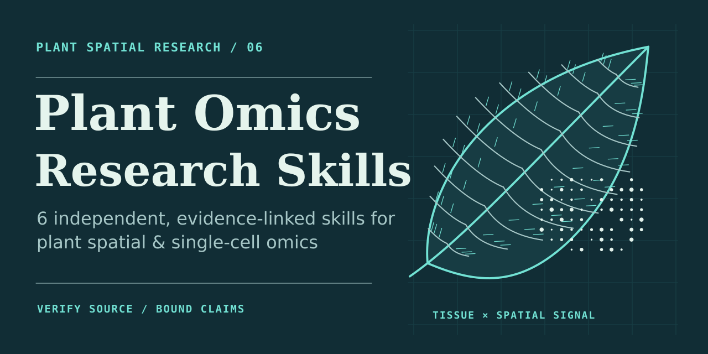
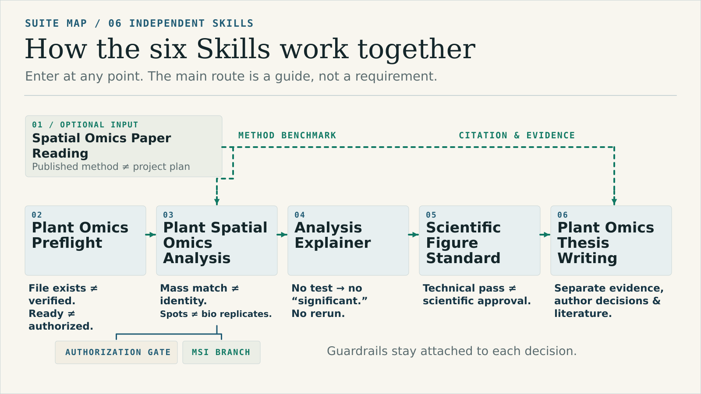
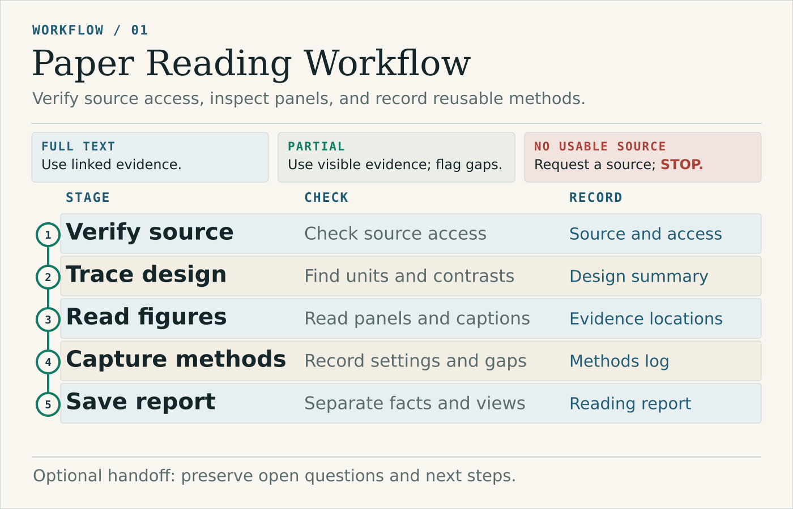
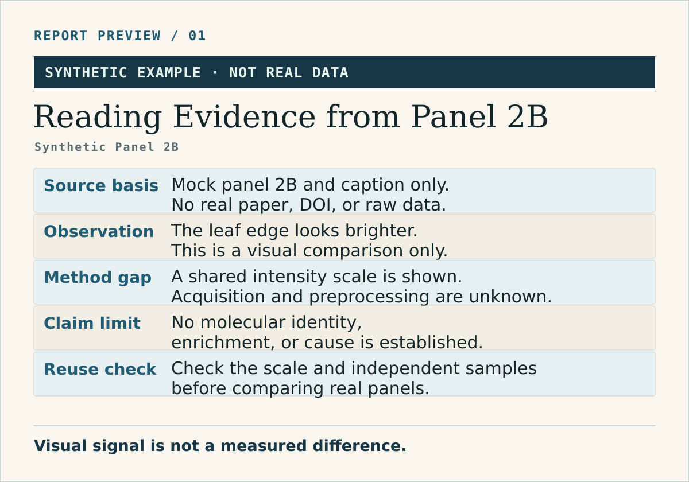

# 植物组学科研 Skills

[English](README.md) · 简体中文

[](LICENSE)




六个面向植物空间组学与单细胞组学研究的独立 Agent Skills。套件提供以证据为基础的科研工作流与质量边界，不是自动分析管线。随附示例均为合成样例，不代表实验结果。

## 核心科研底线

- 已发表的方法不等于当前项目的分析方案。
- 文件存在不等于输入已核实；就绪不等于获得执行授权。
- m/z 匹配不等于确认化合物身份；空间点位不等于生物学重复。
- 未做统计检验，不宣称统计学显著。结果解读不重跑分析。
- 通过技术质检不等于获得科学认可。
- 区分证据、作者决定和文献依据。

## 六个 Skills 如何协作



[可编辑的 Mermaid 源文件](assets/release/suite-architecture.mmd)。按任务选择切入点；图中的连线表示可选交接关系，不要求依次完成六步。

## 选择 Skill

| Skill | 适用场景 | 产出 | 图示 |
| --- | --- | --- | --- |
| [空间组学文献阅读](skills/spatial-omics-paper-reading/SKILL.md) | 阅读已发表的论文、图版或方法 | 可回溯证据的阅读简报，按需附交接记录 | [工作流](assets/release/spatial-omics-paper-reading/workflow.png) · [报告预览](assets/release/spatial-omics-paper-reading/report-preview.png) |
| [植物组学预检](skills/plant-omics-preflight/SKILL.md) | 开始前核对数据身份、就绪程度或任务范围 | 记录已核实输入、阻断项和下一步检查的就绪备忘 | [工作流](assets/release/plant-omics-preflight/workflow.png) · [报告预览](assets/release/plant-omics-preflight/report-preview.png) |
| [植物空间组学分析](skills/plant-spatial-omics-analysis/SKILL.md) | 规划、诊断或执行已获授权的比较，含质谱成像（MSI） | 限定范围的方案或比较记录，注明样本保留情况和证据边界 | [工作流](assets/release/plant-spatial-omics-analysis/workflow.png) · [报告预览](assets/release/plant-spatial-omics-analysis/report-preview.png) |
| [分析结果解读](skills/analysis-explainer/SKILL.md) | 解读已有结果，不重跑分析 | 标有证据来源及解释边界的图件摘要 | [工作流](assets/release/analysis-explainer/workflow.png) · [报告预览](assets/release/analysis-explainer/report-preview.png) |
| [科研制图规范](skills/scientific-figure-standard/SKILL.md) | 基于已有结果制图、调整样式或检查图件 | 不改变源结果的图件导出和技术质检 | [工作流](assets/release/scientific-figure-standard/workflow.png) · [报告预览](assets/release/scientific-figure-standard/report-preview.png) |
| [植物组学论文写作](skills/plant-omics-thesis-writing/SKILL.md) | 基于已核实记录起草或修改学位论文章节 | 与证据一致、保留作者决定的文稿 | [工作流](assets/release/plant-omics-thesis-writing/workflow.png) · [报告预览](assets/release/plant-omics-thesis-writing/report-preview.png) |

## 快速安装

通过 GitHub 安装需要能访问已发布的仓库。本地副本可按第三种方式安装。

**1. Open Agent Skills CLI。** 第一条命令用于发现并选择要安装的 Skills；只装一个时，用 `--skill` 指定其目录名。

```sh
npx skills add carrot-wangqian/plant-omics-research-skills
npx skills add carrot-wangqian/plant-omics-research-skills --skill plant-omics-preflight
```

[Skills CLI 文档](https://www.skills.sh/docs/cli)

**2. Claude Code 插件市场。** 先登记仓库，再安装含六个 Skills 的整包插件。在 Claude Code 会话内运行：

```text
/plugin marketplace add carrot-wangqian/plant-omics-research-skills
/plugin install plant-omics-research-skills@plant-omics-research-skills
```

[Claude Code 插件市场文档](https://code.claude.com/docs/en/plugins/create-marketplace)

**3. 通用手动安装。** 将任意完整的 `skills/<skill-name>/` 目录复制到宿主应用指定的 Skills 目录，保留 `SKILL.md` 和相对路径下的 `references/`。六个 Skill 不互相依赖，具体运行仍取决于宿主应用的能力和权限。参见 [Antigravity](https://antigravity.google/docs/skills)、[Codex](https://learn.chatgpt.com/docs/build-skills) 或 [Cursor](https://cursor.com/docs/skills) 的说明。

## 合成示例直览

以文献阅读为例，示范从核验来源到形成可回溯证据的简报，并分别记录观察结果、结论边界和复用前检查。示例数据为合成内容。





在[视觉图集](docs/visual-gallery.md)查看六套完整图示。

## 校验、引用与许可证

- [校验说明与可复现的合成测试](docs/validation.md)
- 引用本套件时，可使用 GitHub 的 **Cite this repository** 或 [CITATION.cff](CITATION.cff)。
- 采用 [MIT 许可证](LICENSE)。
