# Plant Omics Research Skills: Visual Gallery

[English README](../README.md) · [中文 README](../README.zh-CN.md) · [Visual checklist](visual-checklist.md) · [Validation](validation.md)

Visual assets for v1.0.0: six independent, evidence-linked Skills for plant spatial and single-cell omics. Start with the Skill your current task needs; the suite map shows possible handoffs, not a required pipeline.

## Suite overview

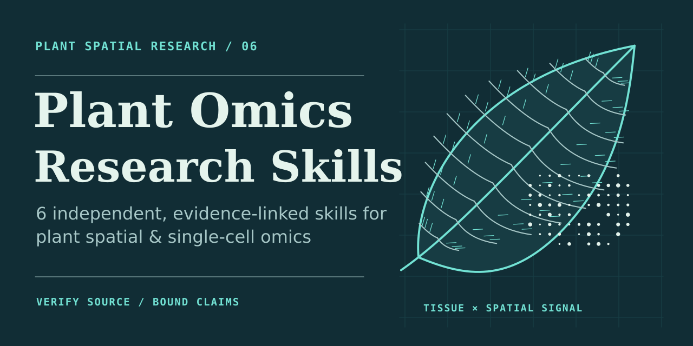

[Hero banner PNG](../assets/release/hero-banner.png) · [Editable SVG](../assets/release/hero-banner.svg)

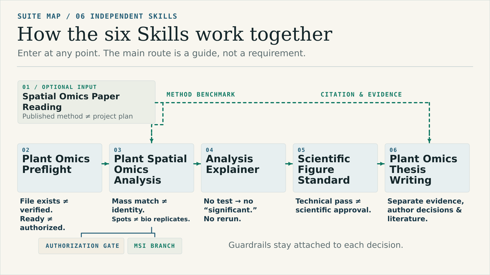

[Suite map PNG](../assets/release/suite-architecture.png) · [Editable SVG](../assets/release/suite-architecture.svg) · [Mermaid source](../assets/release/suite-architecture.mmd)

The main route runs from Preflight through Spatial Omics Analysis, Analysis Explainer, and Scientific Figure Standard to Thesis Writing. Paper Reading can provide a methods reference for analysis and evidence-linked citations for writing. Analysis routes to MSI or other modalities and stops at planning if execution is not authorized.

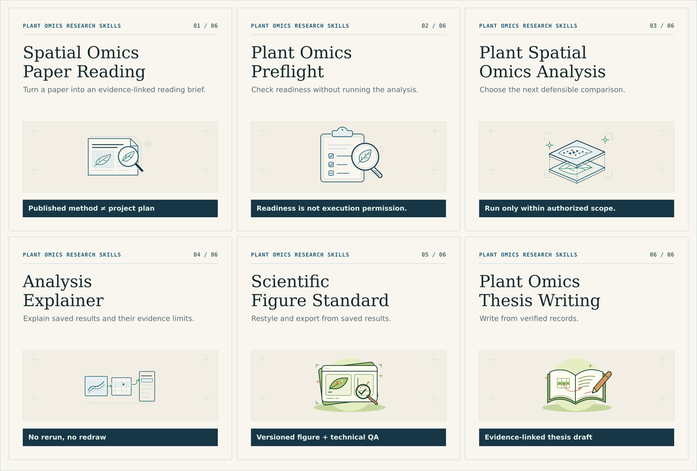

[Card overview PNG](../assets/release/cards-overview.png) · [Editable SVG](../assets/release/cards-overview.svg)

## Skills

Each section includes the workflow in words. Open the full-size PNG or editable SVG to inspect a visual in detail. All report previews are synthetic examples, not real data.

### 01. Spatial Omics Paper Reading

Verify source access. Use only what you can inspect, and stop if nothing is usable. Trace the design, read figures, capture methods, and save an evidence-linked report. Add a handoff only when requested. **Guardrail:** Published method is not a project plan.

<a href="../assets/release/spatial-omics-paper-reading/card.png">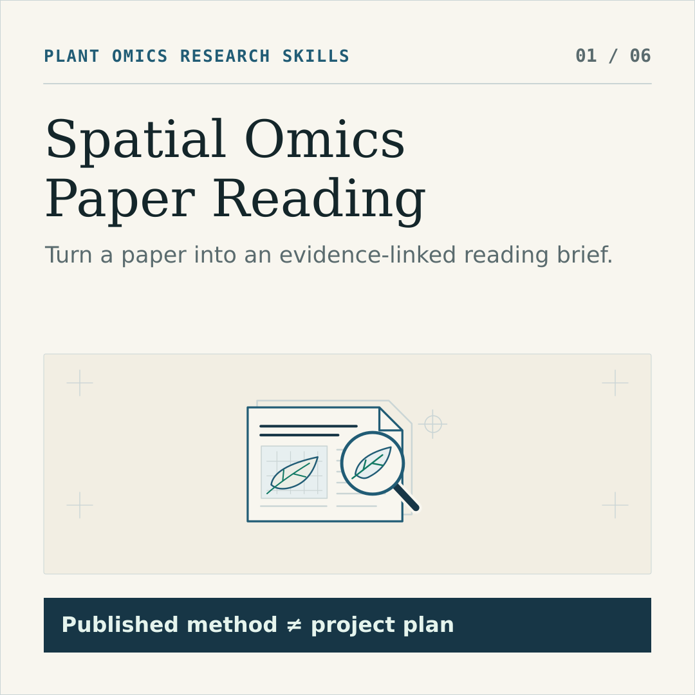</a>

[Card PNG](../assets/release/spatial-omics-paper-reading/card.png) · [Editable card SVG](../assets/release/spatial-omics-paper-reading/card.svg)

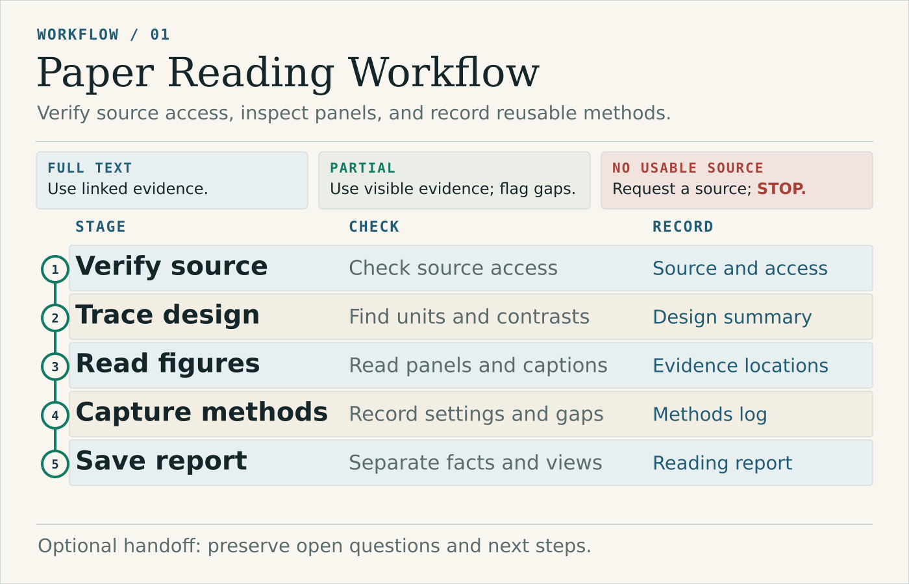

[Workflow PNG](../assets/release/spatial-omics-paper-reading/workflow.png) · [Editable workflow SVG](../assets/release/spatial-omics-paper-reading/workflow.svg) · [Workflow Mermaid source](../assets/release/spatial-omics-paper-reading/workflow.mmd)

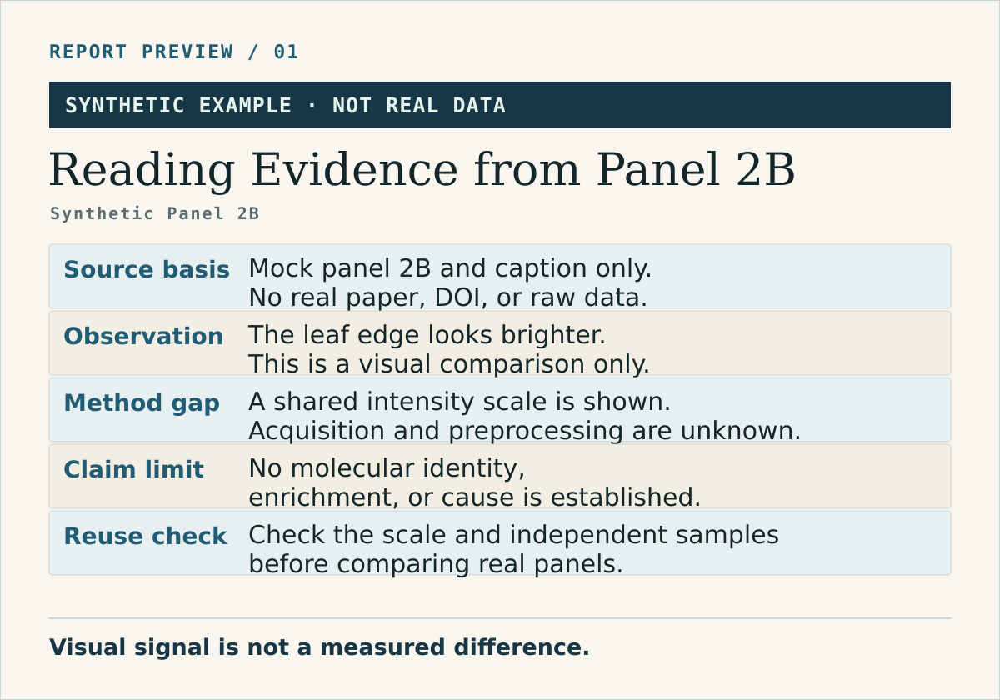

[Report preview PNG](../assets/release/spatial-omics-paper-reading/report-preview.png) · [Editable preview SVG](../assets/release/spatial-omics-paper-reading/report-preview.svg) · [Synthetic reading report](synthetic-reading-report.md) · [Skill instructions](../skills/spatial-omics-paper-reading/SKILL.md)

### 02. Plant Omics Preflight

Choose a review mode, bind inputs, and check modality-specific prerequisites. Record each item as Ready, Conditional, Blocked, or Not Applicable. **Guardrail:** Readiness is not authorization to execute.

<a href="../assets/release/plant-omics-preflight/card.png">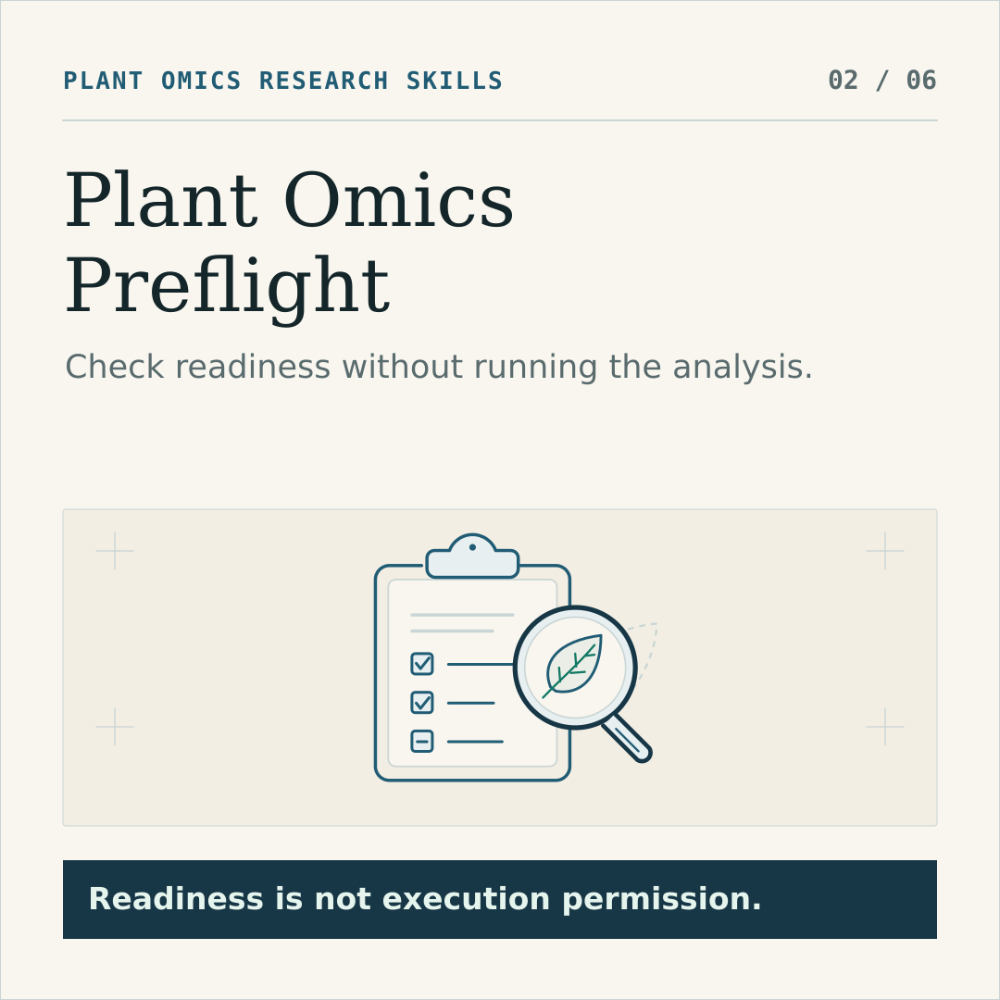</a>

[Card PNG](../assets/release/plant-omics-preflight/card.png) · [Editable card SVG](../assets/release/plant-omics-preflight/card.svg)

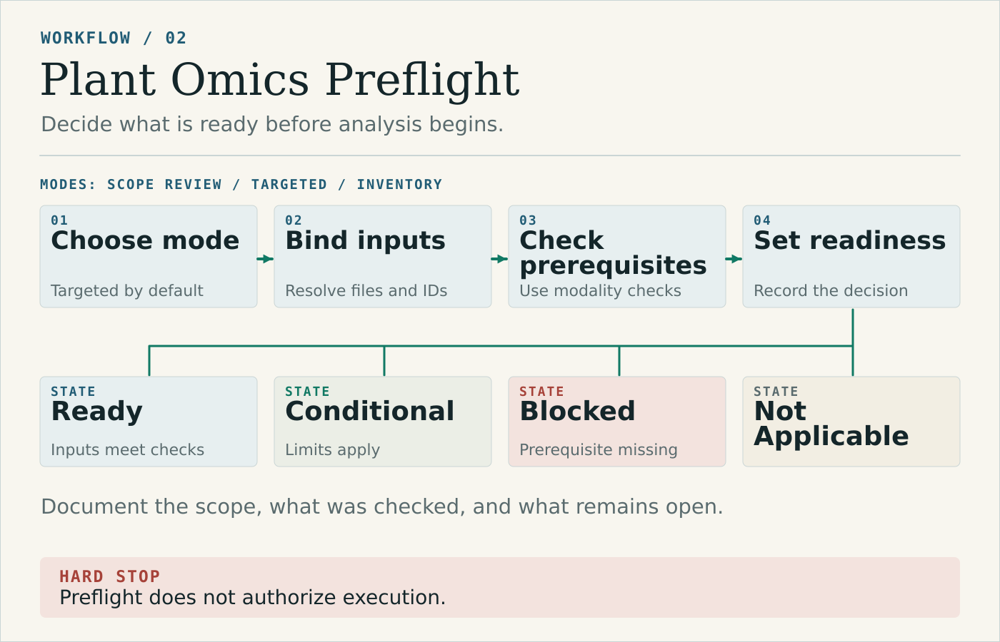

[Workflow PNG](../assets/release/plant-omics-preflight/workflow.png) · [Editable workflow SVG](../assets/release/plant-omics-preflight/workflow.svg) · [Workflow Mermaid source](../assets/release/plant-omics-preflight/workflow.mmd)

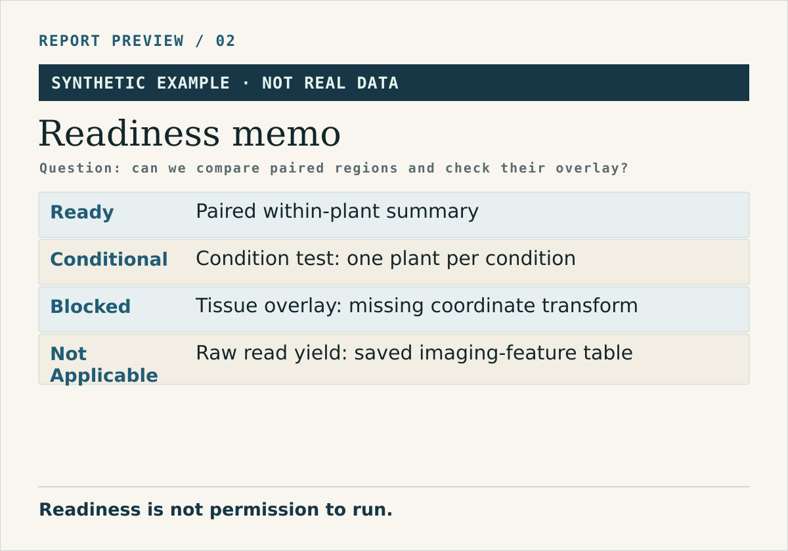

[Report preview PNG](../assets/release/plant-omics-preflight/report-preview.png) · [Editable preview SVG](../assets/release/plant-omics-preflight/report-preview.svg) · [Readiness record](../skills/plant-omics-preflight/references/readiness-record.md) · [Skill instructions](../skills/plant-omics-preflight/SKILL.md)

### 03. Plant Spatial Omics Analysis

Define the comparison, verify the baseline, and route to MSI or the relevant RNA or cross-modality branch. Compare options, run only within authorization, audit retention and denominators, and record the decision. Missing is not zero. **Guardrail:** A mass match is not identification; spots are not biological replicates.

<a href="../assets/release/plant-spatial-omics-analysis/card.png">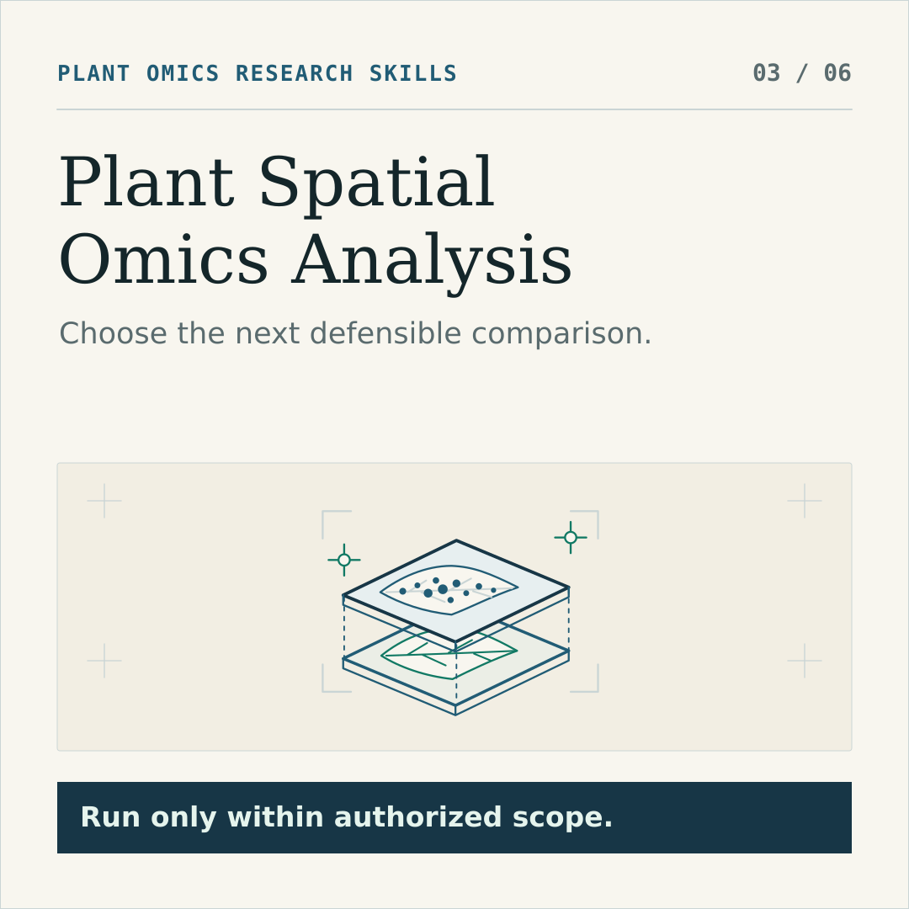</a>

[Card PNG](../assets/release/plant-spatial-omics-analysis/card.png) · [Editable card SVG](../assets/release/plant-spatial-omics-analysis/card.svg)

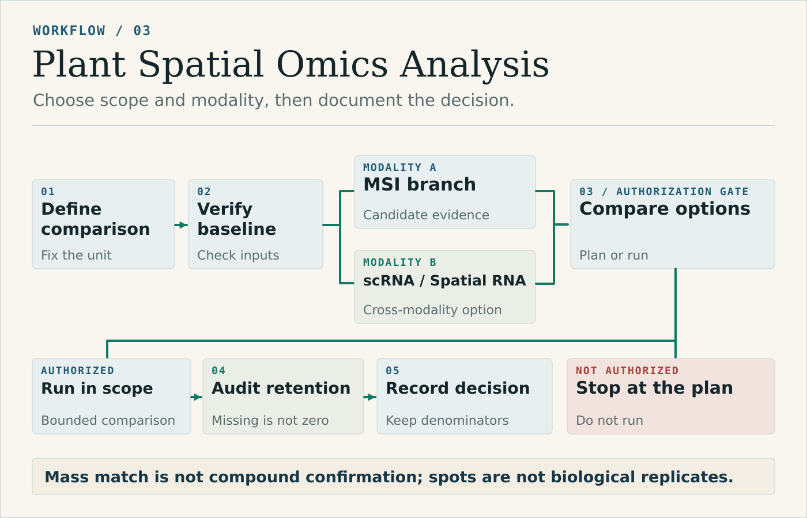

[Workflow PNG](../assets/release/plant-spatial-omics-analysis/workflow.png) · [Editable workflow SVG](../assets/release/plant-spatial-omics-analysis/workflow.svg) · [Workflow Mermaid source](../assets/release/plant-spatial-omics-analysis/workflow.mmd)

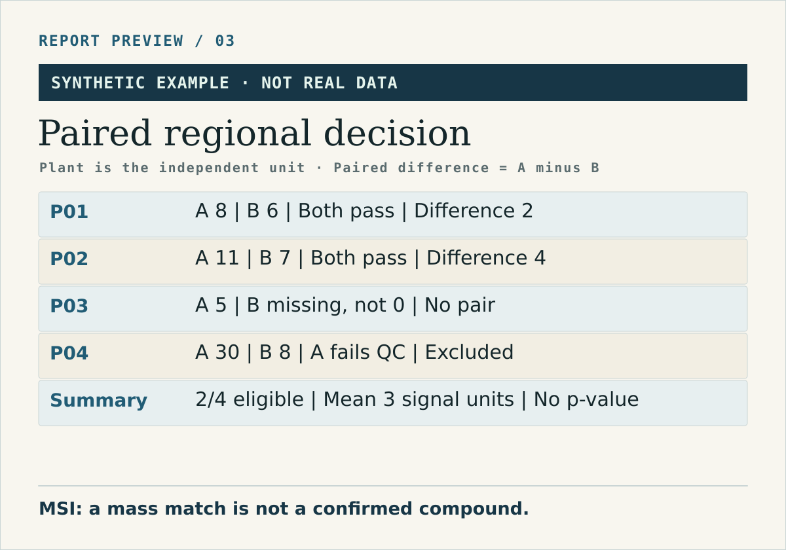

[Report preview PNG](../assets/release/plant-spatial-omics-analysis/report-preview.png) · [Editable preview SVG](../assets/release/plant-spatial-omics-analysis/report-preview.svg) · [Decision record](../skills/plant-spatial-omics-analysis/references/decision-record.md) · [Skill instructions](../skills/plant-spatial-omics-analysis/SKILL.md)

### 04. Analysis Explainer

Read existing tables and renders. Explain the method and biological unit; separate observation, inference, interpretation, and hypothesis. Deliver a Figure Summary. **Guardrail:** No rerun or redraw. No significance claim without a statistical test.

<a href="../assets/release/analysis-explainer/card.png">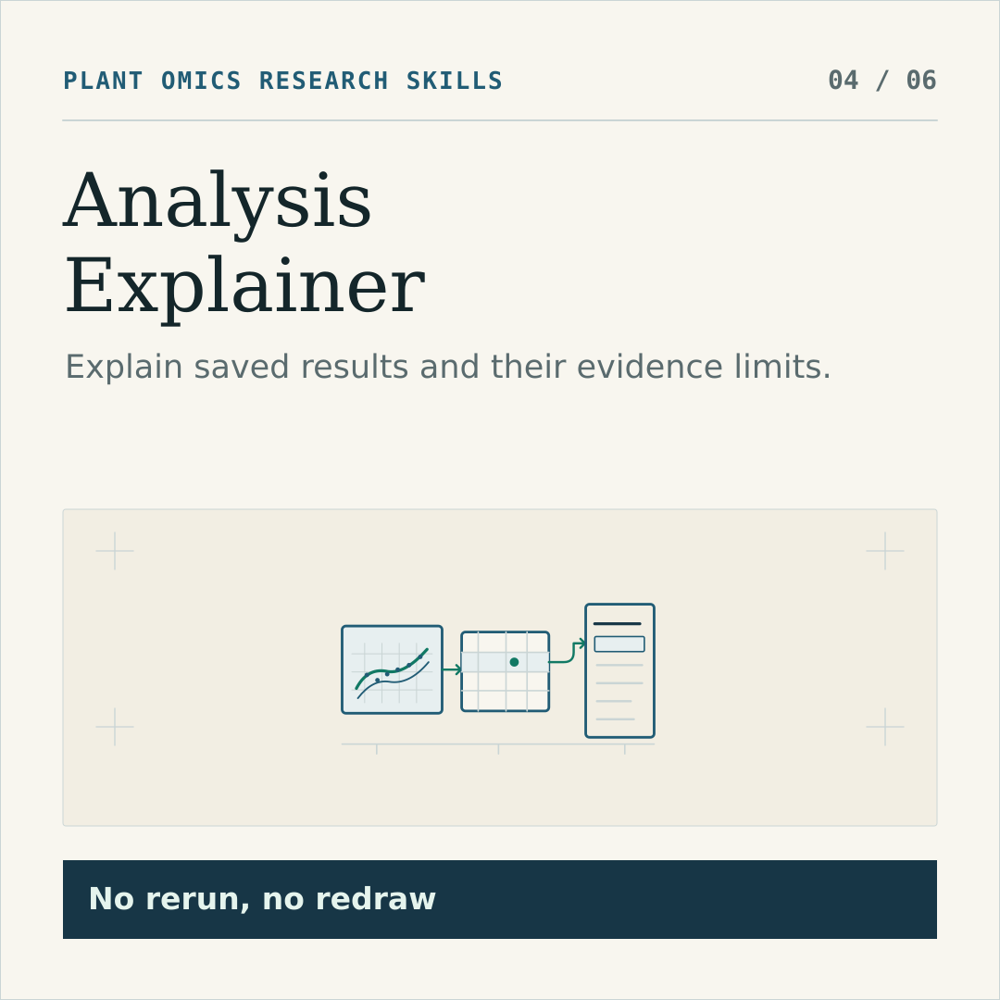</a>

[Card PNG](../assets/release/analysis-explainer/card.png) · [Editable card SVG](../assets/release/analysis-explainer/card.svg)

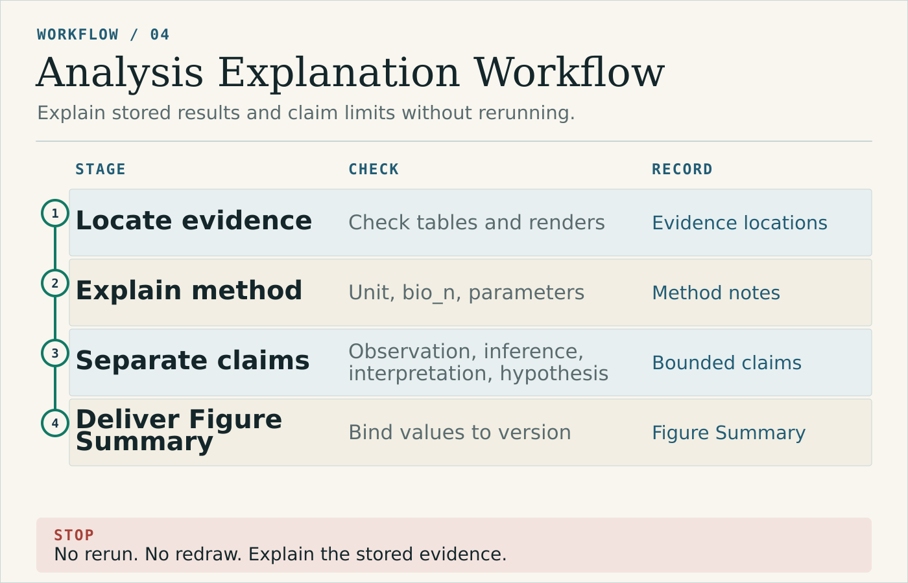

[Workflow PNG](../assets/release/analysis-explainer/workflow.png) · [Editable workflow SVG](../assets/release/analysis-explainer/workflow.svg) · [Workflow Mermaid source](../assets/release/analysis-explainer/workflow.mmd)

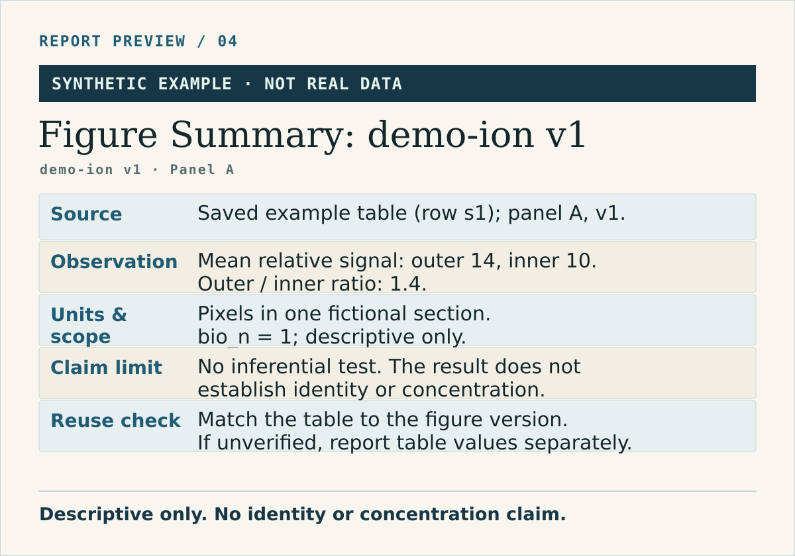

[Report preview PNG](../assets/release/analysis-explainer/report-preview.png) · [Editable preview SVG](../assets/release/analysis-explainer/report-preview.svg) · [Figure Summary template](../skills/analysis-explainer/references/figure-summary.md) · [Skill instructions](../skills/analysis-explainer/SKILL.md)

### 05. Scientific Figure Standard

Lock the source, render the vector PDF and preview PNG, then check fonts, scale, contrast, and crop. Deliver the versioned figure with its QA verdict. **Guardrail:** Technical pass is not scientific approval.

<a href="../assets/release/scientific-figure-standard/card.png">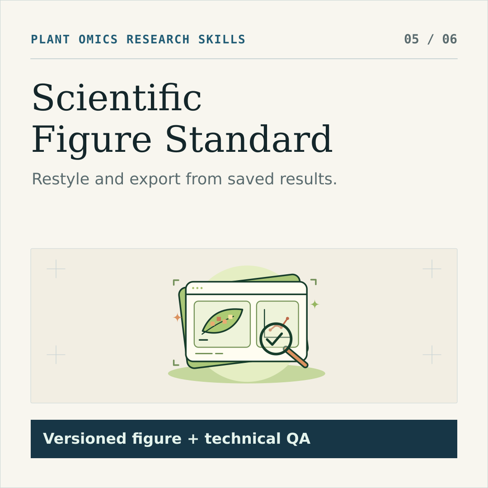</a>

[Card PNG](../assets/release/scientific-figure-standard/card.png) · [Editable card SVG](../assets/release/scientific-figure-standard/card.svg)

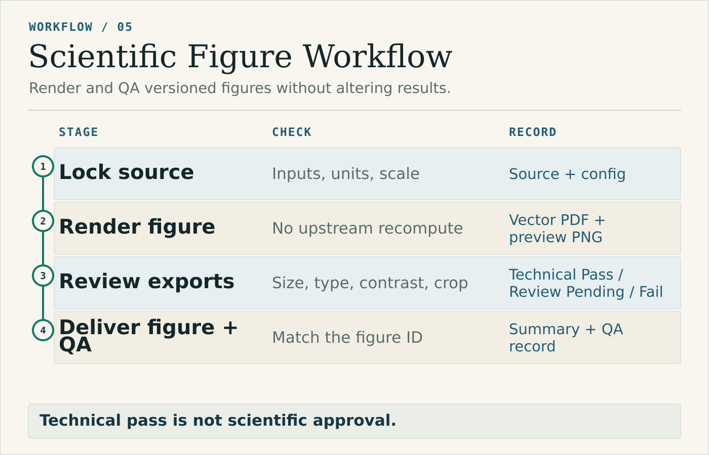

[Workflow PNG](../assets/release/scientific-figure-standard/workflow.png) · [Editable workflow SVG](../assets/release/scientific-figure-standard/workflow.svg) · [Workflow Mermaid source](../assets/release/scientific-figure-standard/workflow.mmd)

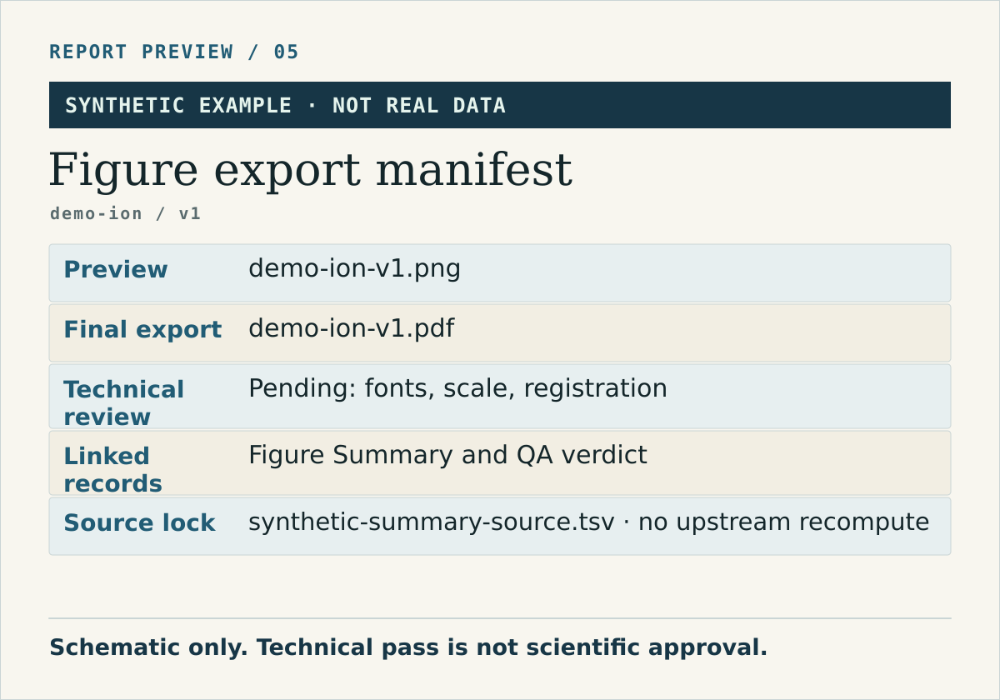

[Report preview PNG](../assets/release/scientific-figure-standard/report-preview.png) · [Editable preview SVG](../assets/release/scientific-figure-standard/report-preview.svg) · [Figure Summary reference](../skills/scientific-figure-standard/references/figure-summary.md) · [Skill instructions](../skills/scientific-figure-standard/SKILL.md)

### 06. Plant Omics Thesis Writing

Set the scope and protected elements, map claims to evidence, and keep Results separate from Discussion. Verify citations, panels, units, and feature sets; deliver a tracked diff and unresolved items. **Guardrail:** Evidence, author decisions, and literature stay distinct.

<a href="../assets/release/plant-omics-thesis-writing/card.png">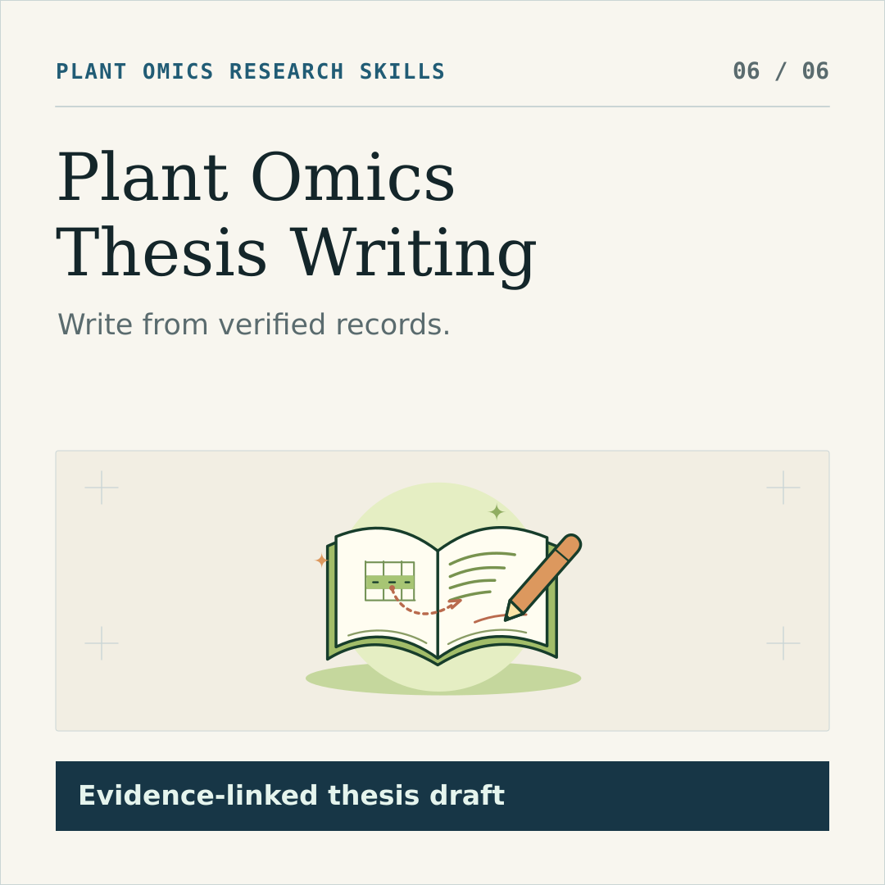</a>

[Card PNG](../assets/release/plant-omics-thesis-writing/card.png) · [Editable card SVG](../assets/release/plant-omics-thesis-writing/card.svg)

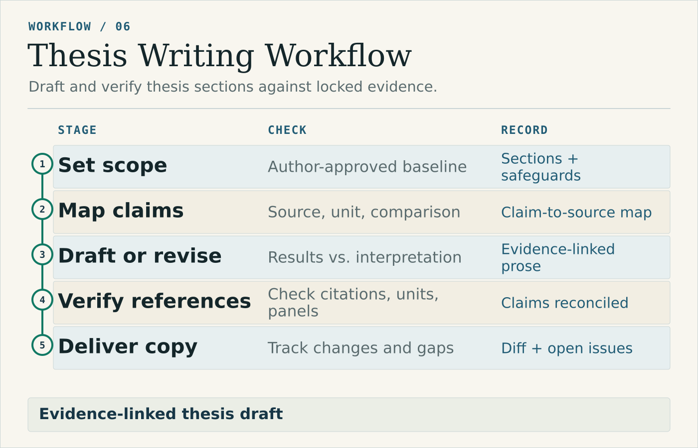

[Workflow PNG](../assets/release/plant-omics-thesis-writing/workflow.png) · [Editable workflow SVG](../assets/release/plant-omics-thesis-writing/workflow.svg) · [Workflow Mermaid source](../assets/release/plant-omics-thesis-writing/workflow.mmd)

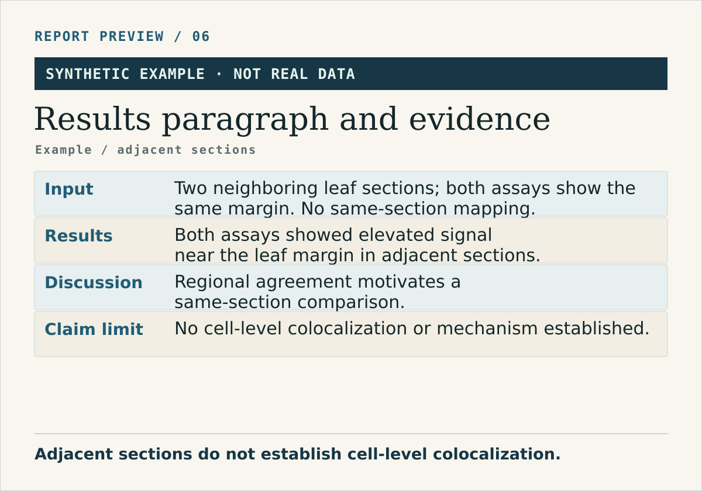

[Report preview PNG](../assets/release/plant-omics-thesis-writing/report-preview.png) · [Editable preview SVG](../assets/release/plant-omics-thesis-writing/report-preview.svg) · [Claims and chapter logic](../skills/plant-omics-thesis-writing/references/claims-and-chapter-logic.md) · [Skill instructions](../skills/plant-omics-thesis-writing/SKILL.md)
